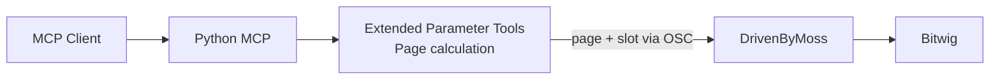
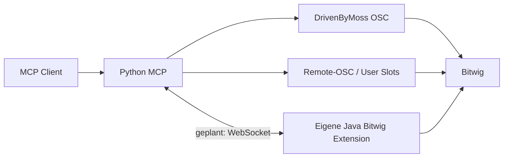
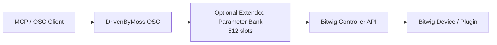

# Architecture Evolution

## Phase 0 — Übernommene Upstream-Architektur

**Zeitraum:** vor Oktober 2025


### Motivation

Vorhandenes Open-Source-Projekt mit MCP-Tools, OSC-Kommunikation und Browser-/Device-Infrastruktur nutzen.

### Festgestellte Grenzen

Beim eigenen Start Transport-/Konfigurationsprobleme; später die 8er-Parameterbank.

### Historischer Status

**VERIFIED** als Ausgangsarchitektur.

---

## Phase 1 — Inbetriebnahme und MCP-seitiges Parameter-Paging

**Zeitraum:** 11.–23.10.2025



### Auslöser

1. MCP-Initialisierung/STDIO funktionierte nicht zuverlässig.
2. Danach zeigte sich, dass nur acht Parameter einer Remote-Control-Page adressierbar waren.

### Lösung

DrivenByMoss blieb unverändert. Der MCP berechnete die passende Seite und adressierte anschließend den Slot innerhalb der 8er-Bank.

### Vorteil

Kleine Änderung im Python-Projekt und keine sofortige Modifikation von DrivenByMoss.

### Grenze

Paging blieb an die bestehende Page-Semantik gekoppelt und löste keine anderen Capability-Lücken.

### Grund für die nächste Veränderung

Die November-Analyse zeigte wesentlich größere Automatisierungslücken.

### Historischer Status

**IMPLEMENTED**; vollständige Live-Verifikation **UNKNOWN**.

---

## Phase 2 — Hybrid-Roadmap: Remote-OSC + Java Bridge + WebSocket

**Zeitraum:** 12.–15.11.2025



### Auslöser

Capability-Analyse eines komplexen Setups; historisch nur ungefähr 50 % Abdeckung des gewünschten Workflows.

### Lösungsbausteine

- Sprint 1: Remote-OSC, Batchparameter, YAML-Mappings.
- Sprint 2: Java-Bitwig-Extension und WebSocket-Bridge.
- Sprint 3: Unified Mapping & Controller Integration.
- spätere Phase: Clip-/Projekt-/Export-Funktionen.

### Sichtbare Grenzen

- Sprint 1 blieb Plan/Issue.
- Sprint 2 war Starter/Skeleton.
- Bridge-Artefakte wurden am 12.11. mehrfach hinzugefügt, gelöscht und erneut hinzugefügt.
- Sprint 3 blieb Planung.
- keine Quelle belegt eine zusammenhängend laufende Hybridarchitektur.

### Grund für die nächste Veränderung

Expliziter Ablösebeschluss: **UNKNOWN – historical evidence insufficient**.

Im März wurde der ursprüngliche Parameterblocker jedoch erneut direkt in DrivenByMoss adressiert.

---

## Phase 3 — DrivenByMoss-Fork mit `allparams`

**Zeitraum:** 10.–13.03.2026



Bestehende API blieb vorgesehen:

```text
/device/param/{1..8}/...
```

Neu:

```text
/device/allparams/count
/device/allparams/{index}/value
/device/allparams/{index}/name
/device/allparams/list
/device/allparams/list/{offset}
/device/allparams/byname
/device/allparams/error
```

### Auslöser

Der 8-Parameter-Blocker sollte nicht mehr nur außerhalb von DrivenByMoss durch Page-Orchestrierung behandelt werden. Die März-Analyse kam zum Schluss, dass bloßes Erhöhen einer bestehenden Bank nicht genügte und strukturelle Erweiterungen nötig waren.

### Implementierung

PR #3:

- `EXTENDED_PARAMETER_BANK_SIZE = 512`,
- `FullParameterInfo`,
- Framework-Lookup-API,
- `ExtendedParameterBankImpl`,
- 64 × 8 Pages als zusammenhängende Sicht,
- opt-in Initialisierung.

PR #4:

- OSC-Handler für `allparams`,
- Index- und Namenszugriff,
- `begin/item/end`-Dump-Protokoll,
- Multi-Value-OSC-Writer,
- Fehlerkanal.

### Vorteile, die der Ansatz adressierte

- alte 8er-API bleibt unverändert,
- seitenunabhängiger externer Zugriff,
- Parameternamen als OSC-Argumente statt im Pfad,
- größere, aber begrenzte Sicht,
- Backend-seitige Lösung statt MCP-seitiger Page-Logik.

### Offene Grenzen

- Build scheiterte in Codex-Umgebung an Maven-403,
- PRs blieben offen/unmerged,
- keine Bitwig-Live-Verifikation belegt,
- Codex-Reviews fanden konkrete Robustheitsfragen,
- Serum-Dump-Tool hatte eine mögliche Callback-Race-Condition.

### Historischer Status

**IMPLEMENTED auf Branches, nicht VERIFIED.**

---

## Verhältnis der Phasen zueinander

Belegt ist:

- Phase 1 löste das konkrete 8er-Problem im MCP.
- Phase 2 entstand wegen größerer Capability-Lücken.
- Phase 3 löste denselben Parameterblocker erneut, diesmal in DrivenByMoss.

Nicht belegt ist:

- dass Phase 2 offiziell verworfen wurde,
- dass `allparams` die Java-Bridge unnötig machen sollte,
- dass Remote-OSC nach März ausdrücklich aufgegeben wurde,
- dass Phase 1 entfernt oder als technisch falsch erklärt wurde.

Die Architekturgeschichte ist daher eine Folge sich verschiebender Zuständigkeitsgrenzen, nicht eine sauber versionierte Zielarchitektur.
