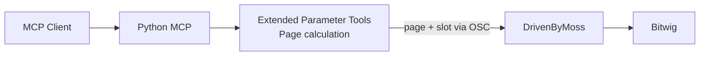
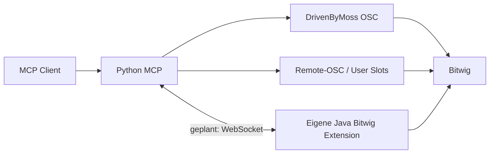
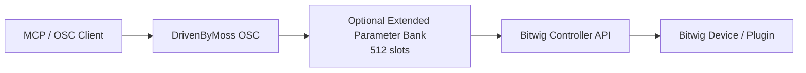

# Bitwig MCP Project History — Combined Bundle


---

# FILE: docs/project-history/README.md

# Project History

Dieser Ordner enthält die rekonstruierte historische Dokumentation des Bitwig-MCP-Projekts rund um:

- `Andy-Post/bitwig-mcp-server`
- `Andy-Post/DrivenByMoss`
- Upstream `git-moss/DrivenByMoss`

Schwerpunkt sind Oktober/November 2025 und März 2026. Die Rekonstruktion basiert auf historischen Chat-Indizes und Zusammenfassungen, erhaltenen Projektartefakten sowie der noch sichtbaren GitHub-Historie.

## Zweck

Die Dateien dienen als gemeinsames Projektgedächtnis für Fable, Claude/Opus, Claude Code, GPT-SOL, Codex und andere Coding-/Reasoning-Agenten. Sie sollen verhindern, dass alte Zwischenlösungen als aktuelle Architekturvorgaben behandelt, bereits bekannte Grenzen erneut entdeckt oder Planung und Implementierung miteinander verwechselt werden.

## Wichtige Abgrenzung

**Dies ist historische Dokumentation, keine aktuelle Architekturentscheidung.**

Der heutige Repository-Stand wurde nur verwendet, um historische Artefakte, Commits, Issues und Pull Requests wiederzuerkennen. Aus diesen Dateien folgt keine Empfehlung für die künftig zu verwendende Architektur.

## Historische Statusklassen

- **VERIFIED** — durch damaligen Live-Test, Log, Code-/Build-Ergebnis oder eindeutige Quelle bestätigt.
- **IMPLEMENTED** — Code bzw. Artefakt wurde erstellt, eine Live-Verifikation ist aber nicht ausreichend belegt.
- **PLANNED** — als Aufgabe, Sprint, Roadmap oder konkreter Umsetzungsplan vorgesehen.
- **PROPOSED** — als mögliche Lösung bzw. Architekturidee diskutiert.
- **ABANDONED** — ausdrücklich verworfen.
- **SUPERSEDED** — durch einen späteren Ansatz überholt.
- **UNKNOWN** — aus den verfügbaren historischen Quellen nicht sicher bestimmbar.

Wo die Quellen nicht ausreichen, wird ausdrücklich **UNKNOWN – historical evidence insufficient** verwendet.

## Empfohlene Lesereihenfolge

1. `PROJECT_CONTEXT.md`
2. `DEVELOPMENT_TIMELINE.md`
3. `ARCHITECTURE_EVOLUTION.md`
4. `HISTORICAL_DECISIONS.md`
5. `CAPABILITY_HISTORY.md`
6. `OPEN_QUESTIONS_FROM_HISTORY.md`
7. `SOURCE_INDEX.md`

## Quellenprinzip

Repository-nahe Belege und damalige Test-/PR-Angaben haben Vorrang vor nachträglichen Zusammenfassungen. Historische Chat-Zusammenfassungen werden als Sekundärbelege behandelt. Wo die Original-Chats nicht als Volltext verfügbar waren, wird keine zusätzliche Sicherheit konstruiert.


---

# FILE: docs/project-history/PROJECT_CONTEXT.md

# Project Context

## Ziel des Projekts

Das Projekt sollte einen AI-/MCP-gesteuerten Zugriff auf Bitwig Studio ermöglichen. Ausgangspunkt war ein Python-MCP-Server, der MCP-/JSON-RPC-Anfragen über OSC an die Open-Sound-Control-Integration von DrivenByMoss weiterleitete.

Historischer Basispfad:

```text
AI/MCP client
    |
    | MCP / JSON-RPC over STDIO
    v
bitwig-mcp-server (Python)
    |
    | OSC / UDP
    v
DrivenByMoss OSC controller
    |
    | Bitwig Controller API
    v
Bitwig Studio
```

Der Fork `Andy-Post/bitwig-mcp-server` basiert auf einem bereits vorhandenen Projekt. Der Repository-Hinweis, dass Dokumentation und Implementierung auseinanderliegen können, ist für die Historie wichtig: vorhandene Roadmaps oder Toollisten sind nicht automatisch Beweis für tatsächliche Funktion.

## Oktober 2025: Inbetriebnahme und erster Blocker

Zwischen 11. und 23.10.2025 wurde der vorhandene MCP-Server praktisch in Betrieb genommen und erweitert.

Historisch belegt sind:

- ein Initialize-/Startproblem mit etwa 60 Sekunden Timeout,
- Prüfung der OSC-Portkonfiguration,
- Identifikation einer fehlenden bzw. fehlerhaften STDIO-Transportkette und falscher Settings-Attributnamen,
- Dokumentation von rund 27 MCP-Tools,
- ein realer Zugriffsbeschränkung auf jeweils acht Device-Parameter,
- ein eigener Fork,
- sechs Extended-Parameter-Tools mit Paginglogik.

Eine spätere Projektauswertung nennt einen OSC-Listener auf `127.0.0.1:9000` sowie die Verbindung zu Bitwig auf `127.0.0.1:8000`. Damit ist ein funktionierender Server-/OSC-Pfad sekundär belegt. Die vollständigen Original-Logs sind jedoch nicht erhalten.

## Die 8-Parameter-Grenze

Für Device-Parameter war der Zugriff auf eine Bank von acht Parametern begrenzt. Bei Geräten mit deutlich mehr Parametern — historisch wird EQ+ mit 40+ Parametern als Beispiel genannt — war damit nur ein Teil direkt adressierbar.

Im Oktober wurde dies zunächst im MCP durch Paging adressiert. Die sinngemäße Seitenauswahl war:

```text
page = (parameter_index - 1) // 8
```

Historische Einordnung:

- 8-Parameter-Limit: **VERIFIED**
- Paging-Konzept: **IMPLEMENTED**
- sechs Extended-Parameter-Tools: **IMPLEMENTED**
- vollständiger Bitwig-Live-Test aller sechs Tools: **UNKNOWN – historical evidence insufficient**

## November 2025: das Problem wird größer als „nur acht Parameter“

Am 12.11.2025 wurde ein komplexeres Rumble-/Multi-Layer-Setup systematisch daraufhin untersucht, welche Schritte über den damaligen MCP/DrivenByMoss-Pfad automatisierbar waren.

Eine historische Zusammenfassung beziffert die Abdeckung grob mit etwa 50 %. Diese Zahl ist als damalige Arbeitsbewertung zu verstehen, nicht als heute reproduzierter Benchmark.

Daraus entstand eine 4-Phasen-Roadmap:

1. OSC-Erweiterung,
2. eigene Java-Bitwig-Extension,
3. WebSocket-Bridge,
4. zusätzliche Clip-/Projekt-/Export-Funktionalität.

Die Roadmap war **PLANNED**, nicht fertig implementiert.

## November 2025: mehrere Lösungswege parallel

### Remote-OSC / Sprint 1

`Sprint 1 – Extended Parameter Control (Remote-OSC)` plante im Python-MCP:

- `python-osc`,
- OSC-Bundles,
- einen Remote-OSC-Wrapper,
- `/user/0001…/1024`,
- YAML-/JSON-Mappings,
- Batch-Parametersteuerung,
- Smoke-Tests für EQ+ und Compressor.

Die Aufgaben und Acceptance Criteria sind im erhaltenen Sprint-Dokument nicht als abgeschlossen belegt.

Status: **PLANNED**.

Dieser Ansatz ist historisch nicht identisch mit der Oktober-Paging-Lösung.

### Java Bridge / Sprint 2

Unter `bridge/bitwig-extension` wurde ein Java-Starter eingecheckt. Die README nennt ihn ausdrücklich einen minimalen Startpunkt für Sprint 2 und nennt noch offene Arbeiten:

- Bitwig Controller API als Dependency ergänzen,
- WebSocket-Server in `WSHandler` implementieren,
- lauffähige `.bwextension` daraus machen.

Status:

- Java-Bridge-Skeleton: **IMPLEMENTED**
- funktionierende Java/WebSocket-Bridge: **UNKNOWN – historical evidence insufficient**

Die Commit-Historie zeigt am 12.11.2025 mehrfaches Hinzufügen, Löschen und erneutes Hinzufügen von Bridge-Artefakten. Das ist ein konkreter Repository-Beleg für die damalige Bewegung der Architekturartefakte.

### Unified Mapping / Sprint 3

Am 15.11.2025 wurden Sprint-3-Dokumente für einen gemeinsamen Mapping-/Controller-Layer angelegt und mehrfach überarbeitet.

Historischer Status: **PLANNED**.

## Browser, Device Navigation und ChromaDB

Browser-, Device-Navigation-, Layer- und ChromaDB-Artefakte stammen zum Teil bereits aus dem Upstream-Projekt vor dem eigenen Fork. Die übernommene Git-Historie enthält im März/April 2025 bereits:

- Device-spezifische URIs,
- Browser-Pagination,
- echte MCP-/Bitwig-Integrationstests,
- Browser-Indexer und OSC Query Tools.

Am 22.11.2025 wurde laut historischem Chatindex die Browser-Index-Funktion live getestet.

Daher:

- Existenz der Browser-/ChromaDB-Infrastruktur: **VERIFIED**
- Browser-Index-Livetest am 22.11.2025: **VERIFIED**
- vollständige Funktionsfähigkeit aller Browser-/Recommendation-Funktionen im eigenen Setup: **UNKNOWN – historical evidence insufficient**

## März 2026: der Parameterblocker wird in DrivenByMoss selbst adressiert

Im März 2026 wurde das Projekt erneut aufgenommen. Der Arbeitsweg wurde diesmal stärker auf den DrivenByMoss-Fork verlagert.

Belegt sind:

1. kritische Überarbeitung eines Codex-Auftrags zur Entfernung der 8-Parameter-Grenze,
2. Ergänzung von Backward Compatibility, Observer-Pattern und UDP-Paketgrößen als Anforderungen,
3. Review mit GPT-5.4 Pro; sieben Verbesserungen übernommen, ein spekulativer Codevorschlag verworfen,
4. Codex/GitHub-Workflow ohne lokalen Clone,
5. GitHub-Anbindung in Codex,
6. erneute Abgrenzung zwischen MCP, DrivenByMoss und eigener Extension.

## `allparams` war mehr als eine Idee

Am 13.03.2026 entstanden sieben offene Pull Requests im DrivenByMoss-Fork.

Wesentlich:

- PR #3 implementierte eine optionale Extended Parameter Bank mit 512 Slots und Lookup-API.
- PR #4 implementierte OSC-Handler für `/device/allparams/*` und einen Multi-Value-OSC-Writer.
- PR #5 dokumentierte die Architektur.
- PR #6 dokumentierte Build-Validierung und einen manuellen Bitwig-Testplan.
- PR #7 implementierte ein Serum-2-Parameter-Dump-Tool.

Adressraum:

```text
/device/allparams/count
/device/allparams/{index}/value
/device/allparams/{index}/name
/device/allparams/list
/device/allparams/list/{offset}
/device/allparams/byname
/device/allparams/error
```

PR #3 setzte die 512-Slot-Sicht aus 64 Seiten × 8 Parametern zusammen. PR #4 ließ die bestehende `/device/param/{1..8}/...`-API unangetastet.

## Entscheidender Verifikationsstatus im März

Die März-PRs berichten übereinstimmend:

- Buildversuche wurden durchgeführt.
- Maven scheiterte bei `maven-enforcer-plugin:3.6.2` mit HTTP 403.
- Vollständige Kompilierung/Integration konnte nicht bestätigt werden.
- Eine Bitwig-Live-Verifikation ist in den PRs nicht belegt.
- Die PRs wurden nicht in `master` gemergt und sind weiterhin offen.

Daher:

- `allparams`-Spezifikation: **PLANNED**
- Framework-Implementierung PR #3: **IMPLEMENTED**
- OSC-Handler PR #4: **IMPLEMENTED**
- Doku/Testplan PR #5/#6: **IMPLEMENTED** als Dokumentation
- Serum-2-Dump-Tool PR #7: **IMPLEMENTED**, Syntaxprüfung bestanden
- erfolgreicher Java-Build: **UNKNOWN – historical evidence insufficient**
- Live-Funktion in Bitwig: **UNKNOWN – historical evidence insufficient**

## Warum mehrere technische Ansätze nebeneinander existieren

Der Verlauf war nicht linear:

1. **Oktober:** vorhandene Architektur lauffähig machen und die 8er-Bank durch MCP-Paging umgehen.
2. **November:** größere Capability-Lücken führen zu einer Hybrid-Roadmap mit Remote-OSC, Java-Bridge/WebSocket und Mapping-Layer.
3. **März:** der konkrete Parameterblocker wird erneut betrachtet und diesmal tiefer in DrivenByMoss mit `allparams` adressiert.

Nicht belegt ist, dass alle jeweils älteren Ansätze ausdrücklich verworfen wurden. Teilweise wurden sie funktional überholt, teilweise nur liegen gelassen.

Das ist der zentrale historische Grund, warum heute mehrere technische Ansätze nebeneinander im Projektgedächtnis auftauchen.


---

# FILE: docs/project-history/DEVELOPMENT_TIMELINE.md

# Development Timeline

| Datum | Phase | Ereignis | Ergebnis | Status | Quelle |
|---|---|---|---|---|---|
| 25.–28.03.2025 | Upstream-Vorgeschichte | Upstream erweitert Device-URIs, Browser-Pagination und echte MCP-/Bitwig-Integrationstests. | Browser-/Navigation-Infrastruktur existiert bereits vor dem eigenen Fork. | VERIFIED | übernommene Git-Historie |
| 10.04.2025 | Upstream-Vorgeschichte | Browser-Indexer und OSC Query Tools werden aktualisiert. | Browser-Index ist kein erst im November 2025 entstandenes Feature. | VERIFIED | Commit `120f7a0` |
| 11.10.2025 | Inbetriebnahme | MCP-Server beantwortet Initialize nicht zuverlässig; ca. 60-s-Timeout diagnostiziert. | Start-/Transportproblem eingegrenzt. | VERIFIED | Claude-Chat #35 |
| 14.10.2025 | Transport | STDIO-Transport/Serverstart bearbeitet; falsche Settings-Namen identifiziert. | Transportcode laut Historie umgesetzt; späterer Server-/OSC-Betrieb belegt. | IMPLEMENTED / teilweise VERIFIED | Claude-Chat #36; Sekundärquelle |
| 14.10.2025 | Tool-Inventar | Rund 27 MCP-Tools dokumentiert. | Historischer Toolbestand systematisch erfasst. | VERIFIED als Dokumentationsereignis | Claude-Chat #37 |
| 14.10.2025 | Dokumentation | Tool-Referenz und Beispiel-Prompts erstellt. | Bedien-/Testkontext entsteht. | VERIFIED als Dokumentationsereignis | Claude-Chat #38 |
| 16.10.2025 | Parameter | 8-Parameter-Limit als Blocker identifiziert. | Geräte mit >8 Parametern nicht vollständig direkt erreichbar. | VERIFIED | Claude-Chat #39 |
| 16.10.2025 | Parameter | Sechs Extended-Parameter-Tools mit Paginglogik spezifiziert/umgesetzt. | MCP soll passende 8er-Seite automatisch wählen. | IMPLEMENTED | Claude-Chat #40 |
| 23.10.2025 | Git/Übergabe | Änderungen für Git-Commit vorbereitet. | Implementierung für Repository-Übernahme aufbereitet. | VERIFIED als Arbeitsereignis | Claude-Chat #41 |
| 12.11.2025 | Capability-Analyse | Grenzen von DrivenByMoss/MCP anhand komplexerer DAW-Automation untersucht. | Historische Arbeitsbewertung: etwa 50 % des gewünschten Workflows abdeckbar. | VERIFIED als damalige Bewertung | Claude-Chat #42 |
| 12.11.2025 | Roadmap | 4-Phasen-Roadmap OSC → Java Extension → WebSocket → Clip/Projekt/Export. | Lösungsraum über MCP-Paging hinaus erweitert. | PLANNED | Claude-Chat #43 |
| 12.11.2025 | Sprint 1 | Remote-OSC-/Batch-/YAML-Mapping-Sprint angelegt. | Tasks und Acceptance Criteria dokumentiert, nicht als erfüllt belegt. | PLANNED | Commit `89147a9` |
| 12.11.2025 | Sprint 2 | Java-Bridge-Starter mehrfach hinzugefügt/entfernt/wieder hinzugefügt. | Skeleton vorhanden; WebSocket/Bitwig-API-Anbindung noch TODO. | IMPLEMENTED als Skeleton | Commitserie 12.11. |
| 15.11.2025 | Sprint 3 | Unified-Mapping-/Controller-Dokumente angelegt und überarbeitet. | gemeinsamer Mapping-Layer geplant. | PLANNED | `eba24bc` u.a. |
| 22.11.2025 | Live-Test | MCP-Fähigkeiten, insbesondere Browser Index, live getestet. | Browser-Index-Funktion historisch live verifiziert. | VERIFIED | Claude-Chat #44 |
| 10.03.2026 | Wiederaufnahme | Codex-Auftrag zur Entfernung der 8-Parameter-Grenze kritisch überarbeitet. | Backward Compatibility, Observer-Pattern, UDP-Paketgrößen berücksichtigt. | VERIFIED als Reviewereignis | Claude-Chat #142 |
| 10.03.2026 | Review | Codex-Tasks mit GPT-5.4-Pro-Review abgeglichen. | 7 Verbesserungen übernommen, 1 spekulativer Vorschlag verworfen. | VERIFIED | Claude-Chat #143 |
| 10.03.2026 | Workflow | Codex/GitHub-Workflow ohne lokalen Clone eingerichtet. | Cloudbasierter Arbeitsweg vorbereitet. | VERIFIED | Claude-Chat #144 |
| 11.03.2026 | Workflow | GitHub-Anbindung in Codex konfiguriert. | Voraussetzung für Branch-/PR-Arbeit geschaffen. | VERIFIED | Claude-Chat #146 |
| 13.03.2026 | Architekturabgrenzung | MCP-Anforderung vs. DrivenByMoss-Erweiterung abgegrenzt. | Zuständigkeitsschichten erneut explizit diskutiert. | VERIFIED als Analyseereignis | Claude-Chat #150 |
| 13.03.2026 | DrivenByMoss Task 1 | `ANALYSIS.md` zu OSC-Architektur/Build erzeugt. | Dokumentations-only; Build scheitert an Maven-403. | IMPLEMENTED | PR #1 |
| 13.03.2026 | DrivenByMoss Task 2 | Parameterhandling und 8er-Grenze codebasiert analysiert. | bloßes Vergrößern der Bank als unzureichend bewertet. | IMPLEMENTED als Analyse | PR #2 |
| 13.03.2026 | DrivenByMoss Task 3 | optionale 512er Extended Parameter Bank implementiert. | Framework-API für Index-/Namenszugriff vorhanden; Build nicht vollständig verifiziert. | IMPLEMENTED | PR #3 |
| 13.03.2026 | DrivenByMoss Task 4 | `/device/allparams/*`-Handler und Multi-Value-OSC-Writer implementiert. | neue OSC-API auf Branch, alte 8er-API bleibt erhalten. | IMPLEMENTED | PR #4 |
| 13.03.2026 | DrivenByMoss Task 5 | `ARCHITECTURE.md` für allparams erstellt. | Adressen, 512-Limit, Dump-Protokoll und Integrationstouchpoints spezifiziert. | PLANNED / IMPLEMENTED als Doku | PR #5 |
| 13.03.2026 | DrivenByMoss Task 6 | Build-Validierung und manueller Bitwig-Testplan dokumentiert. | Build weiterhin durch Maven-403 blockiert; kein Live-Test belegt. | IMPLEMENTED als Doku | PR #6 |
| 13.03.2026 | DrivenByMoss Task 7 | `serum2_param_dump.py` erstellt. | Python-Syntax erfolgreich geprüft; realer Bitwig-/Serum-Lauf nicht belegt. | IMPLEMENTED | PR #7 |
| 07.–08.08.2026 | Später Kontext | Separate native Bitwig-Controller-Extension-Prompts für MX-1/TB-3 reviewed. | zeigt spätere Controller-API-Arbeit, aber keinen MCP-Projektfortschritt. | VERIFIED als separates Kontextprojekt | Claude-Chats #192–197 |

## Verlauf in Kurzform

```text
Inbetriebnahme
    -> Paging-Workaround
    -> größere Capability-Lücken erkannt
    -> Hybrid-/Bridge-/Remote-OSC-Roadmap
    -> Stillstand
    -> erneute Fokussierung auf Parameterblocker
    -> allparams-Implementierung auf ungemergten DrivenByMoss-Branches
    -> fehlende Build-/Live-Verifikation
```

Ein expliziter historischer Beschluss, der alle vorherigen Architekturansätze sauber ablöst, ist nicht belegt.


---

# FILE: docs/project-history/HISTORICAL_DECISIONS.md

# Historical Decisions

## HD-001 — DrivenByMoss als OSC-Backend

**Datum:** spätestens 11.10.2025  
**Problem:** Bitwig sollte von einem externen MCP-Client steuerbar sein.  
**Damalige Entscheidung:** vorhandene Architektur `MCP -> OSC -> DrivenByMoss -> Bitwig` übernehmen und zuerst lauffähig machen.  
**Begründung:** DrivenByMoss bot bereits OSC-Controller und Bitwig-Controller-API-Schicht.  
**Alternativen:** eigene Bitwig Extension; direktere Bridge.  
**Ergebnis:** Server-/OSC-Pfad in Betrieb genommen; spätere Capability-Lücken blieben.  
**Heutiger historischer Status:** **VERIFIED** als verwendete Ausgangsarchitektur.  
**Quellen:** Claude-Chats #35–40; Repository-Historie.

## HD-002 — Extended Parameter Paging im MCP

**Datum:** 16.10.2025  
**Problem:** nur acht Device-Parameter gleichzeitig adressierbar.  
**Damalige Entscheidung:** Seitenwahl im MCP automatisieren; sinngemäß `page = (parameter_index - 1) // 8`.  
**Begründung:** vorhandene 8er-Bank nutzen, ohne DrivenByMoss sofort zu ändern.  
**Alternativen:** Backend ändern; größere native Parameterbank; eigene Extension.  
**Ergebnis:** sechs Extended-Parameter-Tools laut Historie implementiert und codebezogen geprüft.  
**Heutiger historischer Status:** **IMPLEMENTED**. Vollständige Live-Verifikation: **UNKNOWN – historical evidence insufficient**.  
**Quellen:** Claude-Chats #39/#40; Sekundärzusammenfassungen.

## HD-003 — Capability-Gap als größeres Architekturproblem

**Datum:** 12.11.2025  
**Problem:** komplexes Rumble-/Multi-Layer-Setup zeigte Grenzen jenseits der Parameterbank.  
**Damalige Entscheidung:** Funktionsumfang systematisch erfassen und breitere Roadmap formulieren.  
**Begründung:** historische Bewertung von nur ungefähr 50 % Abdeckung des gewünschten Workflows.  
**Ergebnis:** 4-Phasen-Roadmap.  
**Heutiger historischer Status:** **VERIFIED** als damalige Analyse/Entscheidung; Prozentzahl ist historische Schätzung.  
**Quellen:** Claude-Chats #42/#43.

## HD-004 — Remote-OSC als Sprint 1

**Datum:** 12.11.2025  
**Problem:** skalierbarer Parameterzugriff, Batch-Steuerung und gerätespezifische Zuordnung.  
**Damalige Entscheidung:** Remote-OSC im Python-MCP, OSC-Bundles und YAML-/JSON-Mappings.  
**Begründung:** User-Slots und Batchzugriff sollten die 8er-Bank umgehen bzw. ergänzen.  
**Alternativen:** nur DrivenByMoss-Paging; direkte Java-Bridge.  
**Ergebnis:** Sprint-Dokument mit Tasks, Ports und Acceptance Criteria.  
**Heutiger historischer Status:** **PLANNED**.  
**Quellen:** `sprint1-extended-parameter-control.md`, Commit `89147a9`.

## HD-005 — Eigene Java-Bitwig-Extension / Sprint 2

**Datum:** 12.11.2025  
**Problem:** OSC-/MCP-Ebene schien nicht alle benötigten Fähigkeiten für stabile Zieladressierung und tiefe DAW-Funktionen abzudecken.  
**Damalige Entscheidung:** eigene Bitwig Controller Extension als Bridge vorsehen.  
**Begründung:** direkterer Zugriff auf Bitwig Controller API.  
**Alternativen:** DrivenByMoss weiter ausbauen; Remote-OSC allein.  
**Ergebnis:** Java-Starterstruktur eingecheckt; Bitwig-API-Dependency und WebSocket-Server noch offen.  
**Heutiger historischer Status:** **IMPLEMENTED** als Skeleton; funktionierende Bridge **UNKNOWN**.  
**Quellen:** Bridge README; November-Commits.

## HD-006 — WebSocket-Bridge

**Datum:** 12.11.2025  
**Problem:** bidirektionale Kommunikation zwischen Java Extension und MCP.  
**Damalige Entscheidung:** WebSocket als Bridge-Transport vorsehen.  
**Begründung:** persistente Kommunikation und Event-/State-Übertragung.  
**Alternativen:** OSC-only.  
**Ergebnis:** Starterstruktur vorhanden; WebSocket-Server laut README noch zu implementieren.  
**Heutiger historischer Status:** **PLANNED**, mit **IMPLEMENTED** Skeleton.  
**Quellen:** Bridge README.

## HD-007 — Unified Mapping & Controller Layer / Sprint 3

**Datum:** 15.11.2025  
**Problem:** getrennte Mappinglogiken für Remote-OSC, Bridge und Controller sollten vermieden werden.  
**Damalige Entscheidung:** vereinheitlichten Mapping-Layer mit Track→Device→Parameter→Slot, Page/Bank-Abstraktion und YAML/JSON-Import/Export planen.  
**Ergebnis:** Sprint-3-Dokumente mehrfach überarbeitet.  
**Heutiger historischer Status:** **PLANNED**.  
**Quellen:** Commitserie 15.11.2025.

## HD-008 — Clip-/Projekt-/Export-Funktionalität als spätere Phase

**Datum:** 12.11.2025  
**Problem:** Teile des gewünschten DAW-Workflows lagen außerhalb der damaligen OSC-Fähigkeiten.  
**Damalige Entscheidung:** spätere Phase für Clip-/Projekt-/Export-Funktionen.  
**Ergebnis:** Roadmap; Sprint 1 nennt Export/Bounce explizit out of scope.  
**Heutiger historischer Status:** **PLANNED**.  
**Quellen:** Claude-Chat #43; Sprint-1-Dokument.

## HD-009 — März 2026: Parameterproblem in DrivenByMoss selbst lösen

**Datum:** 10.–13.03.2026  
**Problem:** 8-Parameter-Blocker bestand als strukturelles Problem fort.  
**Damalige Entscheidung:** DrivenByMoss um eine optionale seitenunabhängige Parameteransicht bis 512 Slots erweitern, ohne die bestehende 8er-API zu brechen.  
**Begründung:** Backward Compatibility und direkter OSC-Zugriff auf alle von Bitwig exponierten Plugin-Parameter.  
**Alternativen:** page-basierte API weiter orchestrieren; Remote-OSC; eigene Extension.  
**Ergebnis:** PR #3/#4 enthalten Java-Code; PR #5/#6 Design/Testdoku.  
**Heutiger historischer Status:** **IMPLEMENTED**, nicht **VERIFIED**.  
**Quellen:** DrivenByMoss PRs #1–#6.

## HD-010 — `allparams`-Adressraum

**Datum:** 13.03.2026  
**Problem:** Index-, Namens- und Dump-Zugriff auf große Parameterzahlen.  
**Damalige Entscheidung:** eigener Namespace `/device/allparams/...`, Namen als OSC-Argumente, Fehlerkanal und `begin/item/end`-Dump-Protokoll.  
**Begründung:** robuste Protokollstruktur, alte `/device/param/{1..8}/...`-API bleibt erhalten.  
**Ergebnis:** spezifiziert und auf PR-Branch implementiert.  
**Heutiger historischer Status:** **IMPLEMENTED**, Live-Funktion **UNKNOWN**.  
**Quellen:** PR #4/#5.

## HD-011 — Begrenzte Extended Bank statt unbounded allocation

**Datum:** März 2026  
**Problem:** große Parameterlisten ohne unkontrollierte Bankgröße.  
**Damalige Entscheidung:** Obergrenze 512; PR #3 baut 64 × 8 Seiten zu einer Sicht zusammen.  
**Heutiger historischer Status:** **IMPLEMENTED**.  
**Quellen:** PR #3/#5; AGENTS-Spezifikation.

## HD-012 — Codex-Arbeit in getrennten PRs

**Datum:** 10.–13.03.2026  
**Problem:** größere Änderung sollte analysierbar/reviewbar bleiben.  
**Damalige Entscheidung:** Analyse, Framework, OSC-Handler, Architektur, Testplan und Tooling in getrennten Branches/PRs.  
**Ergebnis:** sieben offene PRs.  
**Heutiger historischer Status:** **VERIFIED**.  
**Quellen:** DrivenByMoss PR #1–#7.

## Nicht belegte endgültige Beschlüsse

Für folgende Aussagen gibt es keinen belastbaren historischen Beleg:

- „DrivenByMoss wurde endgültig verworfen.“
- „Die Java Bridge hat Remote-OSC ersetzt.“
- „allparams hat Sprint 1 offiziell abgelöst.“
- „WebSocket wurde als endgültiger Transport beschlossen.“
- „Die Oktober-Paging-Tools wurden als technisch falsch verworfen.“

Status jeweils: **UNKNOWN – historical evidence insufficient**.


---

# FILE: docs/project-history/CAPABILITY_HISTORY.md

# Capability History

## Transport / MCP / STDIO

**Erstmals untersucht:** 11.10.2025  
**Backend:** MCP/JSON-RPC über STDIO → Python → OSC → DrivenByMoss.  
**Problem:** Initialize-/Starttimeout; fehlende/fehlerhafte STDIO-/Settings-Kette.  
**Lösung:** Transport/Serverstart korrigiert.  
**Tests:** spätere Zusammenfassung belegt Serverstart, OSC-Listener `127.0.0.1:9000` und Verbindung zu Bitwig `127.0.0.1:8000`.  
**Letzter historisch belegter Status:** **VERIFIED** für Server-/OSC-Verbindung; vollständiger Original-Initialize-Log nicht erhalten.

## Transportsteuerung

**Backend:** DrivenByMoss OSC.  
**Historische Capabilities:** Play/Stop/Tempo Teil des übernommenen MCP-Bestands.  
**Letzter historisch belegter Status:** **IMPLEMENTED**; individuelle Live-Verifikation jedes Tools **UNKNOWN – historical evidence insufficient**.

## Tracks / Mixer

**Backend:** DrivenByMoss OSC.  
**Historische Capabilities:** Track-Info, Volume, Pan, Mute im übernommenen Projekt.  
**Status:** **IMPLEMENTED**; vollständige eigene Live-Testmatrix **UNKNOWN**.

## Devices

**Backend:** DrivenByMoss OSC.  
**Themen:** Device-Informationen, Device Navigation, später stabile Zieladressierung als Motivation für Bridge/Mapping.  
**Status:** Basisebene **IMPLEMENTED**; komplexe Zieladressierung historisch unvollständig.

## Device Parameters — Basis

**Blocker seit:** 16.10.2025  
**Backend:** DrivenByMoss Remote-Control-Pages mit acht Parametern.  
**Einschränkung:** nur jeweils acht Parameter direkt sichtbar/steuerbar.  
**Status:** **VERIFIED**.

## Device Parameters — Oktober-Paging

**Backend:** Python-MCP orchestriert Page-Wechsel über bestehendes OSC.  
**Lösung:** sechs Extended-Parameter-Tools; Seitenauswahl sinngemäß `(index-1)//8`.  
**Status:** **IMPLEMENTED**.  
**Live-Verifikation:** **UNKNOWN – historical evidence insufficient**.

## Device Parameters — Remote-OSC Sprint 1

**Backend:** Python-MCP → Remote-OSC, `/user/0001…/1024`, OSC Bundles.  
**Lösung:** Batchsteuerung und YAML-Mappings.  
**Geplante Tests:** ≥64 Parameter <100 ms, lokale Roundtrip <10 ms.  
**Status:** **PLANNED**; Acceptance Criteria nicht als erfüllt belegt.

## Device Parameters — `allparams` März 2026

**Backend:** eigener DrivenByMoss-Fork → Bitwig Controller API.  
**Lösung:** optionale 512-Slot-Bank, Index-/Namenslookup, `/device/allparams/*`.  
**Code:** PR #3/#4.  
**Build:** versucht, durch Maven-403 blockiert.  
**Live-Test:** nicht belegt.  
**Status:** **IMPLEMENTED**, nicht **VERIFIED**.

## Device Navigation / Siblings

Diese Funktionen existierten bereits in der übernommenen Upstream-Codebasis.  
**Status Codebasis:** **IMPLEMENTED**.  
**Live-Test im eigenen Setup:** **UNKNOWN – historical evidence insufficient**.

## Device Layers

Bereits Teil der übernommenen Infrastruktur; im November war ein Multi-Layer-Rumble-Setup Teil der Capability-Gap-Analyse.  
**Status Basisfunktion:** **IMPLEMENTED**.  
**Abdeckung komplexer Workflows:** historisch als unvollständig bewertet.

## Browser

Upstream hatte Browsernavigation und Pagination bereits im März 2025 entwickelt und Integrationstests ergänzt. Am 22.11.2025 ist ein Live-Test des Browser Index historisch dokumentiert.  
**Status Browser Index:** **VERIFIED**.  
**Status sämtlicher Browseroperationen:** **UNKNOWN**.

## Browser Index / ChromaDB / Recommendations

Browser-Indexer, ChromaDB-Suche und Recommendation-Foundation stammen aus der übernommenen Codebasis.  
**Status Codebasis:** **IMPLEMENTED**.  
**Status Live-Betrieb im eigenen Setup:** Browser Index **VERIFIED**; vollständige Recommendation-Kette **UNKNOWN**.

## Presets

Keine abgeschlossene Preset-Automation des MCP-Projekts aus der Historie sicher belegt.  
**Status:** **UNKNOWN – historical evidence insufficient**.

## Clips / MIDI

Upstream enthielt bereits Roadmap-/Testarbeit; die eigene November-Roadmap führte Clip-Funktionalität dennoch als spätere Erweiterung.  
**Status bezogen auf vollständige gewünschte MCP-Automation:** **PLANNED / UNKNOWN**.

## Arrangement

Keine belastbare eigene Umsetzung belegt.  
**Status:** **UNKNOWN – historical evidence insufficient**.

## Automation

Parameterwerte konnten grundsätzlich über Controller-/OSC-Pfade geändert werden. Eine vollständige Arrangement-Automations-API ist historisch nicht belegt.  
**Status:** teilweise **IMPLEMENTED**, Gesamtfähigkeit **UNKNOWN**.

## Routing / Sidechain

Sprint 1 beschränkte Routing ausdrücklich auf device-level Sidechain-Parameter und erklärte generisches I/O-Routing für out of scope.  
**Status generisches Routing:** **PLANNED/OUT OF SCOPE** im damaligen Sprint; spätere Umsetzung **UNKNOWN**.

## Bounce

Sprint 1 bezeichnet Export/Bounce als UI-Funktion ohne öffentliche Controller-API und nahm sie aus dem Scope.  
**Status:** **PLANNED** als spätere Capability; Implementierung nicht belegt.

## Export

Wie Bounce.  
**Status:** **PLANNED**; Live-Implementierung **UNKNOWN – historical evidence insufficient**.

## Save / New Project

Keine belastbare historische MCP-Implementierung gefunden.  
**Status:** **UNKNOWN – historical evidence insufficient**.

## Java Extension / Bridge

**Erstmals geplant:** 12.11.2025  
**Artefakt:** `bridge/bitwig-extension` Starter.  
**Offen laut eigener README:** Bitwig Controller API Dependency und WebSocket-Server.  
**Status:** Skeleton **IMPLEMENTED**, lauffähige Extension **UNKNOWN**.

## WebSocket

**Motivation:** bidirektionale Bridge zwischen Java Extension und MCP.  
**Artefakt:** Starterstruktur/`WSHandler`.  
**Status:** **PLANNED**; funktionierende Verbindung **UNKNOWN**.

## Mapping / YAML Mapping

**Sprint 1:** YAML-Mappings für EQ+, Compressor, Tool/Utility geplant.  
**Sprint 3:** einheitliche Mapping Engine mit Track→Device→Param→Slot, Regelauflösung, Page/Bank-Abstraktion und Import/Export geplant.  
**Status:** **PLANNED**.

## Serum-2-Parameter-Dump

**März 2026, PR #7:** Python-CLI implementiert, die `/device/allparams/list` konsumiert und JSON-Mapping erzeugt.  
**Test:** `py_compile` erfolgreich; realer Bitwig-/Serum-Lauf nicht belegt. Codex-Review weist auf mögliche Race Condition durch `ThreadingOSCUDPServer` hin.  
**Status:** **IMPLEMENTED**, nicht **VERIFIED**.


---

# FILE: docs/project-history/ARCHITECTURE_EVOLUTION.md

# Architecture Evolution

## Phase 0 — Übernommene Upstream-Architektur

**Zeitraum:** vor Oktober 2025


### Motivation

Vorhandenes Open-Source-Projekt mit MCP-Tools, OSC-Kommunikation und Browser-/Device-Infrastruktur nutzen.

### Festgestellte Grenzen

Beim eigenen Start Transport-/Konfigurationsprobleme; später die 8er-Parameterbank.

### Historischer Status

**VERIFIED** als Ausgangsarchitektur.

---

## Phase 1 — Inbetriebnahme und MCP-seitiges Parameter-Paging

**Zeitraum:** 11.–23.10.2025



### Auslöser

1. MCP-Initialisierung/STDIO funktionierte nicht zuverlässig.
2. Danach zeigte sich, dass nur acht Parameter einer Remote-Control-Page adressierbar waren.

### Lösung

DrivenByMoss blieb unverändert. Der MCP berechnete die passende Seite und adressierte anschließend den Slot innerhalb der 8er-Bank.

### Vorteil

Kleine Änderung im Python-Projekt und keine sofortige Modifikation von DrivenByMoss.

### Grenze

Paging blieb an die bestehende Page-Semantik gekoppelt und löste keine anderen Capability-Lücken.

### Grund für die nächste Veränderung

Die November-Analyse zeigte wesentlich größere Automatisierungslücken.

### Historischer Status

**IMPLEMENTED**; vollständige Live-Verifikation **UNKNOWN**.

---

## Phase 2 — Hybrid-Roadmap: Remote-OSC + Java Bridge + WebSocket

**Zeitraum:** 12.–15.11.2025



### Auslöser

Capability-Analyse eines komplexen Setups; historisch nur ungefähr 50 % Abdeckung des gewünschten Workflows.

### Lösungsbausteine

- Sprint 1: Remote-OSC, Batchparameter, YAML-Mappings.
- Sprint 2: Java-Bitwig-Extension und WebSocket-Bridge.
- Sprint 3: Unified Mapping & Controller Integration.
- spätere Phase: Clip-/Projekt-/Export-Funktionen.

### Sichtbare Grenzen

- Sprint 1 blieb Plan/Issue.
- Sprint 2 war Starter/Skeleton.
- Bridge-Artefakte wurden am 12.11. mehrfach hinzugefügt, gelöscht und erneut hinzugefügt.
- Sprint 3 blieb Planung.
- keine Quelle belegt eine zusammenhängend laufende Hybridarchitektur.

### Grund für die nächste Veränderung

Expliziter Ablösebeschluss: **UNKNOWN – historical evidence insufficient**.

Im März wurde der ursprüngliche Parameterblocker jedoch erneut direkt in DrivenByMoss adressiert.

---

## Phase 3 — DrivenByMoss-Fork mit `allparams`

**Zeitraum:** 10.–13.03.2026



Bestehende API blieb vorgesehen:

```text
/device/param/{1..8}/...
```

Neu:

```text
/device/allparams/count
/device/allparams/{index}/value
/device/allparams/{index}/name
/device/allparams/list
/device/allparams/list/{offset}
/device/allparams/byname
/device/allparams/error
```

### Auslöser

Der 8-Parameter-Blocker sollte nicht mehr nur außerhalb von DrivenByMoss durch Page-Orchestrierung behandelt werden. Die März-Analyse kam zum Schluss, dass bloßes Erhöhen einer bestehenden Bank nicht genügte und strukturelle Erweiterungen nötig waren.

### Implementierung

PR #3:

- `EXTENDED_PARAMETER_BANK_SIZE = 512`,
- `FullParameterInfo`,
- Framework-Lookup-API,
- `ExtendedParameterBankImpl`,
- 64 × 8 Pages als zusammenhängende Sicht,
- opt-in Initialisierung.

PR #4:

- OSC-Handler für `allparams`,
- Index- und Namenszugriff,
- `begin/item/end`-Dump-Protokoll,
- Multi-Value-OSC-Writer,
- Fehlerkanal.

### Vorteile, die der Ansatz adressierte

- alte 8er-API bleibt unverändert,
- seitenunabhängiger externer Zugriff,
- Parameternamen als OSC-Argumente statt im Pfad,
- größere, aber begrenzte Sicht,
- Backend-seitige Lösung statt MCP-seitiger Page-Logik.

### Offene Grenzen

- Build scheiterte in Codex-Umgebung an Maven-403,
- PRs blieben offen/unmerged,
- keine Bitwig-Live-Verifikation belegt,
- Codex-Reviews fanden konkrete Robustheitsfragen,
- Serum-Dump-Tool hatte eine mögliche Callback-Race-Condition.

### Historischer Status

**IMPLEMENTED auf Branches, nicht VERIFIED.**

---

## Verhältnis der Phasen zueinander

Belegt ist:

- Phase 1 löste das konkrete 8er-Problem im MCP.
- Phase 2 entstand wegen größerer Capability-Lücken.
- Phase 3 löste denselben Parameterblocker erneut, diesmal in DrivenByMoss.

Nicht belegt ist:

- dass Phase 2 offiziell verworfen wurde,
- dass `allparams` die Java-Bridge unnötig machen sollte,
- dass Remote-OSC nach März ausdrücklich aufgegeben wurde,
- dass Phase 1 entfernt oder als technisch falsch erklärt wurde.

Die Architekturgeschichte ist daher eine Folge sich verschiebender Zuständigkeitsgrenzen, nicht eine sauber versionierte Zielarchitektur.


---

# FILE: docs/project-history/SOURCE_INDEX.md

# Source Index

## Historische Claude-Chats

| Datum | Titel/Thema | Quelle | Relevanz |
|---|---|---|---|
| 11.10.2025 | Initialisierungs-Timeout-Diagnose | https://claude.ai/chat/7f9ceb3a-f05f-4724-a197-544f3fd9f1d9 | Initialize, Start, OSC |
| 14.10.2025 | STDIO-Transport-Implementierung | https://claude.ai/chat/131508b6-6d3a-4335-bda5-c3fb10900aa7 | STDIO/Serverstart |
| 14.10.2025 | Tool-Dokumentation (27 Tools) | https://claude.ai/chat/9340544a-edc6-4503-8ee9-231341b28e04 | Tool-Inventar |
| 14.10.2025 | Tool-Referenz & Beispiel-Prompts | https://claude.ai/chat/f87c326c-fdf7-4b56-a035-8b1b61db2864 | Doku/Prompts |
| 16.10.2025 | 8-Parameter-Limit als Blocker | https://claude.ai/chat/1877585b-87be-4cf0-a3ca-e7298122721c | Parameterblocker |
| 16.10.2025 | Extended-Parameter-Tools | https://claude.ai/chat/c62e5aa1-327a-4679-a3ba-055b5f3ab49b | sechs Paging-Tools |
| 23.10.2025 | Änderungen für Git-Commit | https://claude.ai/chat/799a9327-17b2-4292-a4f4-f7037e37fe11 | Übergabestand |
| 12.11.2025 | Grenzen der DrivenByMoss-Automatisierung | https://claude.ai/chat/f33b9784-e991-4fc3-88d6-032dc44f2b24 | Rumble/Capability-Gap |
| 12.11.2025 | 4-Phasen-Roadmap | https://claude.ai/chat/57687973-ea35-42f0-a6e7-6af2d99b750c | OSC/Java/WebSocket |
| 22.11.2025 | Live-Test / Browser Index | https://claude.ai/chat/223c65f3-ec73-4a60-951f-bda28e9f784f | Live-Verifikation |
| 10.03.2026 | DrivenByMoss-Codex-Auftrag kritisch überarbeitet | https://claude.ai/chat/8c94b414-a216-437c-bcda-dfded6a93f7f | allparams-Auftrag |
| 10.03.2026 | Codex-Tasks mit GPT-5.4-Pro-Review | https://claude.ai/chat/aab9edb5-324f-4a1b-835e-9a8720bdcbe4 | Multi-Modell-Review |
| 10.03.2026 | Codex/GitHub ohne lokalen Clone | https://claude.ai/chat/27dbdcbf-1428-4102-a3b9-e8a2e2c6ed15 | Workflow |
| 11.03.2026 | GitHub-Anbindung in Codex | https://claude.ai/chat/af20bd72-f6d2-4b41-92fa-1c54a5cdab0f | PR-/Branch-Setup |
| 13.03.2026 | MCP vs. DrivenByMoss abgegrenzt | https://claude.ai/chat/ec37d599-56e9-495c-acf8-72358e3ed9d0 | Zuständigkeitsgrenzen |

## Späterer separater Bitwig-Kontext

Nicht als Beleg für MCP-Fortschritt verwenden:

- MX-1, 07.08.2026: https://claude.ai/chat/fadba791-b278-4385-b24b-6abf913ac9cf
- MX-1 Review: https://claude.ai/chat/5250001f-e5a3-4d69-9822-168b17670ea1
- MX-1 final: https://claude.ai/chat/4fc4d092-44e4-4f3e-a1ba-c70d68e88828
- TB-3: https://claude.ai/chat/64f3f172-b2a3-459c-918d-08906173c389
- TB-3 v3: https://claude.ai/chat/c0cc8d83-5324-49db-8c95-19cfb8f281cb
- TB-3 final review: https://claude.ai/chat/4137980f-aa62-438d-9ba2-2189c11b454a

## Library-/Zusammenfassungsquellen

### `A_Chat_Liste(1).md`

Chronologischer Index technischer Chats August 2025–August 2026. Liefert Datum, Titel und originale Claude-Chat-URLs.

### `B_Chat_Zusammenfassungen_GESAMT_v3.md`

Sekundärquelle für:

- Chats 35–41: Oktober-MCP-Serie,
- Chats 42–44: November-Grenzen/Roadmap/Live-Test,
- Chats 142–150: März-DrivenByMoss/Codex-Serie.

### `C_Kompetenzprofil*.md`

Nachträgliche Projektverdichtung mit:

- 60-s-Initialize-Timeout,
- OSC-Ports,
- 8-von-40+-Parameterproblem,
- Pagingformel,
- sechs Extended-Parameter-Tools,
- Rumble-/50-%-Bewertung.

Diese Quelle wurde nicht allein verwendet, um unklare Live-Verifikation zu behaupten.

## GitHub — bitwig-mcp-server

Repository: https://github.com/Andy-Post/bitwig-mcp-server

Wichtige Artefakte:

- README: https://github.com/Andy-Post/bitwig-mcp-server/blob/main/README.md
- Sprint 1: https://github.com/Andy-Post/bitwig-mcp-server/blob/main/sprint1-extended-parameter-control.md
- Bridge-Starter: https://github.com/Andy-Post/bitwig-mcp-server/tree/main/bridge/bitwig-extension
- Issues: https://github.com/Andy-Post/bitwig-mcp-server/issues
- Commits: https://github.com/Andy-Post/bitwig-mcp-server/commits/main/

Wichtige Commits:

- `89147a9` — Sprint-1 Remote-OSC, 12.11.2025  
  https://github.com/Andy-Post/bitwig-mcp-server/commit/89147a94c8502ca1e892f75c8b2fc443e4fa7d81
- `a6dafa3`, `ec2d0fd`, `7ac0941`, `85785a6`, `04acf5c` — Bridge-Artefaktbewegungen, 12.11.2025
- `eba24bc` — Sprint-3 Unified Mapping & Controller, 15.11.2025  
  https://github.com/Andy-Post/bitwig-mcp-server/commit/eba24bcd0387d9f68d5bb58e3956d82fc58cca07
- `a331116`, `3b51a8b`, `61c943d`, `507500a` — weitere Sprint-3-Überarbeitungen.

Übernommene Upstream-Historie im Fork:

- `120f7a0` — Browser Indexer + OSC Query Tools, 10.04.2025
- `d750cdc` — reale MCP-Integrationstests mit Bitwig, 28.03.2025
- `1cfa2da` — Browser-Pagination-Integrationstests, 28.03.2025
- `2dd47d2` — Device-spezifische URIs, 25.03.2025.

## GitHub — DrivenByMoss Fork

Repository: https://github.com/Andy-Post/DrivenByMoss

Alle folgenden PRs wurden am 13.03.2026 eröffnet und waren bei der Rekonstruktion weiterhin offen:

1. PR #1 — OSC architecture/build analysis  
   https://github.com/Andy-Post/DrivenByMoss/pull/1
2. PR #2 — Parameter handling/limits analysis  
   https://github.com/Andy-Post/DrivenByMoss/pull/2
3. PR #3 — Optional 512er Extended Parameter Bank  
   https://github.com/Andy-Post/DrivenByMoss/pull/3
4. PR #4 — `/device/allparams` handlers + Multi-Value OSC writer  
   https://github.com/Andy-Post/DrivenByMoss/pull/4
5. PR #5 — Architecture design for allparams  
   https://github.com/Andy-Post/DrivenByMoss/pull/5
6. PR #6 — Build validation + manual Bitwig test plan  
   https://github.com/Andy-Post/DrivenByMoss/pull/6
7. PR #7 — Serum 2 OSC parameter dump tooling  
   https://github.com/Andy-Post/DrivenByMoss/pull/7

PR-Commits, soweit über die PR-Oberfläche belegt:

- #1 `895a009`
- #2 `8039963`
- #3 `d818532`
- #4 `081ed66`
- #5 `fe4ecc5`
- #6 `ce4b7d6`
- #7 `118c2a5`

## GitHub — DrivenByMoss Upstream

Repository: https://github.com/git-moss/DrivenByMoss

Dient als Referenz für die ursprüngliche OSC-/Controller-Schicht. Nicht als Beweis verwenden, dass `allparams` upstream übernommen wurde.

## Quellenlücken

Die vollständigen Originaltexte der Claude-Chats #35–44 und #142–150 waren über die derzeit zugängliche Library nicht als Volltext auffindbar. Vorhanden sind Chatindex, URLs und nachträgliche Zusammenfassungen.

Deshalb bleiben u.a. offen:

- exakte Namen/Signaturen aller 27 Tools,
- exakte Namen aller sechs Oktober-Extended-Parameter-Tools,
- vollständige damalige Testprotokolle,
- genaue Liste aller im Rumble-Setup positiv/negativ getesteten Aktionen.

Für diese Punkte gilt: **UNKNOWN – historical evidence insufficient**.


---

# FILE: docs/project-history/OPEN_QUESTIONS_FROM_HISTORY.md

# Open Questions From History

Diese Datei sammelt ausschließlich historisch offene Punkte. Sie löst sie nicht.

## Parameterpfad

### OQ-001 — Wurden die sechs Oktober-Extended-Parameter-Tools live in Bitwig getestet?

Code-/Review- und Commit-Vorbereitung sind sekundär belegt. Ein eindeutiger Live-Test aller sechs Tools ist nicht erhalten.

**Status:** UNKNOWN – historical evidence insufficient

### OQ-002 — Wie hießen die sechs Oktober-Tools exakt?

Die verfügbare Zusammenfassung nennt Anzahl und Zweck, aber nicht die vollständigen Toolnamen/Signaturen.

**Status:** UNKNOWN – historical evidence insufficient

### OQ-003 — Wurde das Oktober-Paging später bewusst entfernt oder nur nicht weiterverfolgt?

Kein expliziter Ablöse-/Löschbeschluss gefunden.

**Status:** UNKNOWN – historical evidence insufficient

### OQ-004 — Ist `allparams` jemals erfolgreich kompiliert worden?

Die PRs dokumentieren nur fehlgeschlagene Maven-Builds wegen HTTP 403.

**Status:** UNKNOWN – historical evidence insufficient

### OQ-005 — Ist `allparams` jemals in Bitwig live gelaufen?

Kein Live-Testbeleg in den PRs oder zugänglichen historischen Zusammenfassungen.

**Status:** UNKNOWN – historical evidence insufficient

### OQ-006 — Welche DrivenByMoss-PRs müssen technisch gemeinsam betrachtet werden?

PR #3 und #4 bilden offensichtlich Framework + OSC. Ob die Branches sauber kombinierbar waren, wurde historisch nicht vollständig verifiziert.

**Status:** UNKNOWN – historical evidence insufficient

## DrivenByMoss vs. eigene Extension

### OQ-007 — Brauchen wir langfristig DrivenByMoss?

Historisch offen. November plante zusätzliche Wege; März investierte erneut in DrivenByMoss.

**Status:** UNKNOWN – historical evidence insufficient

### OQ-008 — Welche Funktionen benötigen wirklich eine eigene Bitwig Extension?

Die November-Roadmap nahm dies an, aber die exakte Capability-Grenze ist nicht vollständig erhalten.

**Status:** UNKNOWN – historical evidence insufficient

### OQ-009 — War die Java Bridge Ergänzung oder sollte sie DrivenByMoss teilweise ersetzen?

Kein eindeutiger finaler Beschluss.

**Status:** UNKNOWN – historical evidence insufficient

### OQ-010 — Wurde WebSocket je funktionsfähig implementiert?

Der Starter nennt `WSHandler` ausdrücklich als noch zu implementieren.

**Status:** UNKNOWN – historical evidence insufficient

## Remote OSC / Mapping

### OQ-011 — Wurde Remote-OSC durch `allparams` funktional überholt?

Beide adressieren Parameter-Skalierung über unterschiedliche Wege. Ein ausdrücklicher Supersede-Beschluss fehlt.

**Status:** UNKNOWN – historical evidence insufficient

### OQ-012 — Wurden YAML-Mappings für EQ+, Compressor und Tool/Utility erstellt?

Sprint 1 plante sie; keine abgeschlossene Umsetzung gefunden.

**Status:** UNKNOWN – historical evidence insufficient

### OQ-013 — Wurde Sprint 3 Unified Mapping praktisch implementiert?

Plan-/Template-Artefakte sind sichtbar, Produktivcode ist nicht belegt.

**Status:** UNKNOWN – historical evidence insufficient

## Browser / Navigation

### OQ-014 — Welche Browser-Funktionen wurden am 22.11.2025 konkret live getestet?

Der Chatindex nennt Browser-Index, der vollständige Testablauf ist nicht verfügbar.

**Status:** UNKNOWN – historical evidence insufficient

### OQ-015 — Wie vollständig funktionierten ChromaDB und Device Recommendations im eigenen Setup?

Upstream-Code existierte; vollständiger eigener Live-Test nicht belegt.

**Status:** UNKNOWN – historical evidence insufficient

## Weitere Capabilities

### OQ-016 — Welche Funktionen machten die historische „ca. 50 %“-Abdeckung aus?

Der Rumble-/Capability-Chat ist nicht als Volltext verfügbar.

**Status:** UNKNOWN – historical evidence insufficient

### OQ-017 — Welche Funktionen waren dokumentiert, aber nie live getestet?

Ohne Original-Testprotokolle nicht vollständig trennbar.

**Status:** UNKNOWN – historical evidence insufficient

### OQ-018 — Welche Clip-/Arrangement-/Automation-Funktionen waren real erreichbar?

Roadmap zeigt Bedarf, aber keinen vollständigen Ist-Zustand.

**Status:** UNKNOWN – historical evidence insufficient

### OQ-019 — Bounce/Export

Historisch als spätere Capability bzw. im Sprint 1 als out of scope behandelt. Ob ein tragfähiger API-Weg entstand, wurde in dieser Historienrekonstruktion nicht neu untersucht.

**Status:** UNKNOWN – historical evidence insufficient

### OQ-020 — Save / New Project

Keine belastbare historische Implementierung gefunden.

**Status:** UNKNOWN – historical evidence insufficient

## Architekturprozess

### OQ-021 — Welcher Ansatz war beim Einschlafen des Projekts zuletzt akzeptiert?

Die Historie endet nicht mit einem einzigen finalen Architecture Decision Record. März hinterließ mehrere ungemergte PRs.

**Status:** UNKNOWN – historical evidence insufficient

### OQ-022 — Welche November-Artefakte wurden absichtlich verworfen und welche nur liegen gelassen?

Die Add/Delete/Add-Commitfolge zeigt Bewegung, aber keine klare Begründung.

**Status:** UNKNOWN – historical evidence insufficient

### OQ-023 — Welche damaligen KI-Reviewaussagen wurden später widerlegt?

Dokumentiert ist, dass im März sieben Reviewpunkte übernommen und ein spekulativer Codevorschlag verworfen wurde. Eine vollständige Matrix älterer Review-Widersprüche fehlt.

**Status:** UNKNOWN – historical evidence insufficient

## Historische Prüfobjekte für einen späteren Audit

Ohne hier eine Empfehlung auszusprechen, sollte ein späterer Audit diese Artefakte getrennt betrachten:

- Oktober-Paging im Python-MCP,
- November Remote-OSC Sprint 1,
- November Java-Bridge-Starter,
- November Sprint-3-Mapping,
- März DrivenByMoss PR #3/#4,
- März Design-/Test-PRs #5/#6,
- März Serum-Dump-Tool #7.
